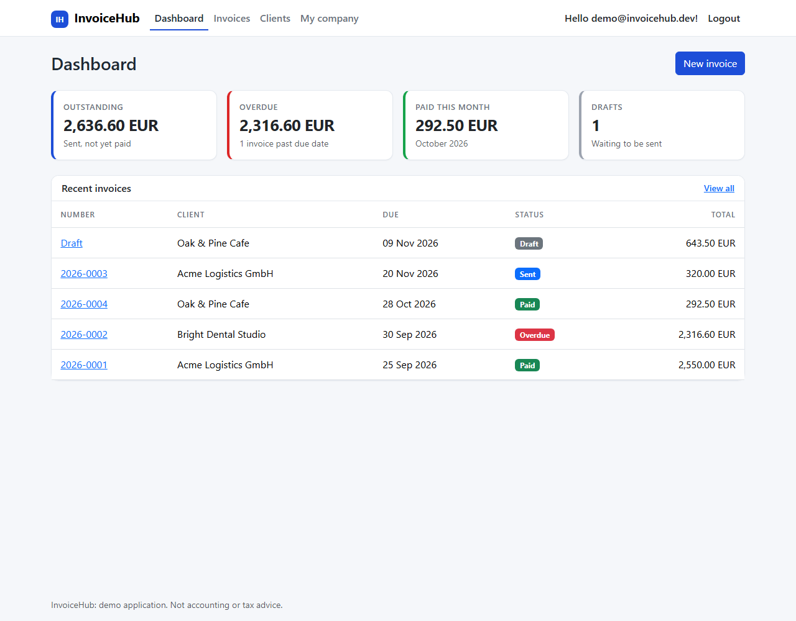
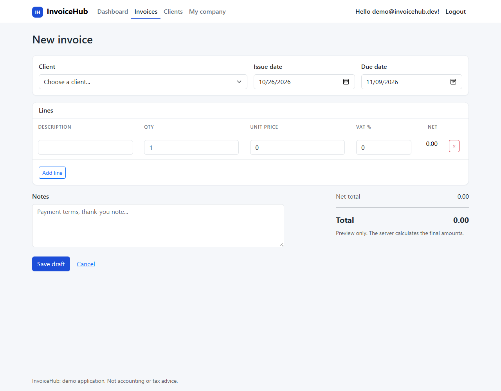
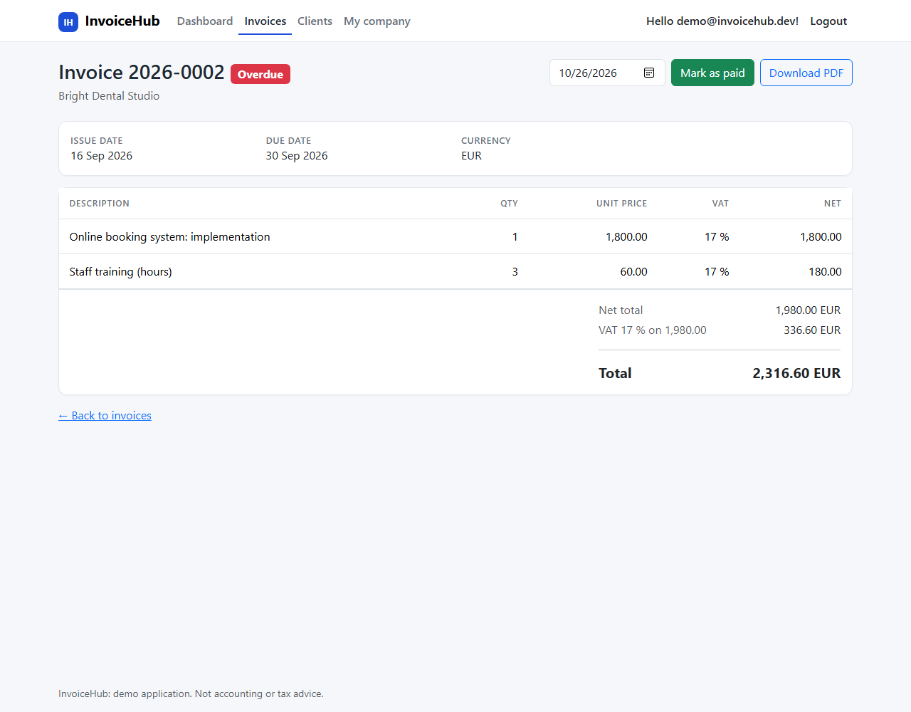
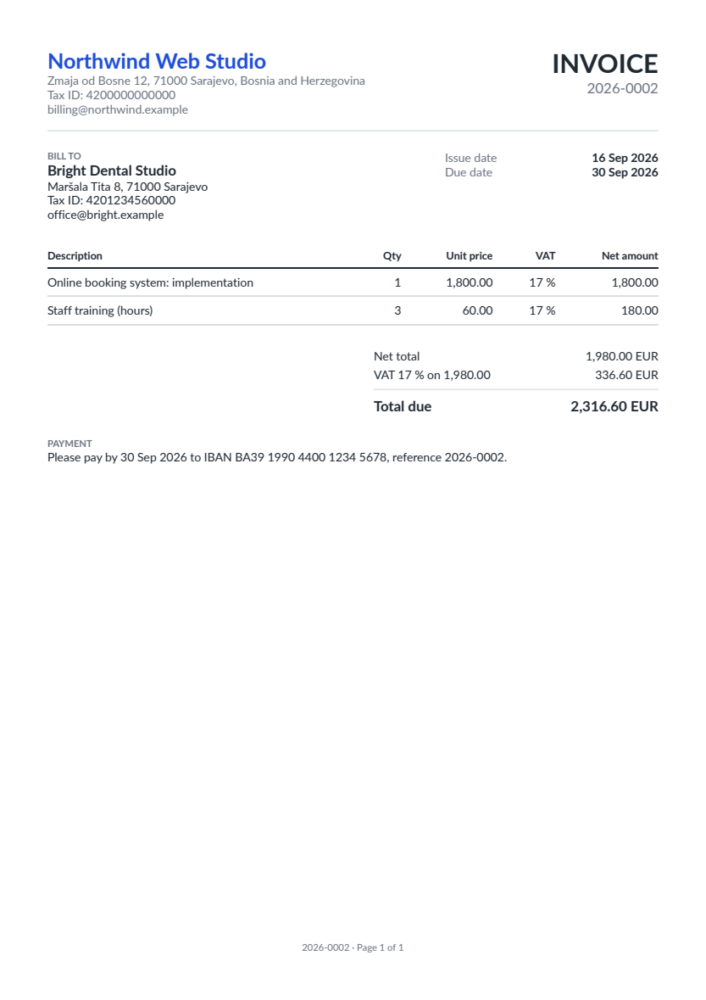

# InvoiceHub

[](https://github.com/Emir0404/InvoiceHub/actions/workflows/ci.yml)

A multi-user **invoicing web app for freelancers and small businesses**, built with ASP.NET Core 10 MVC,
EF Core and ASP.NET Core Identity. Keep clients, draft invoices with VAT, send them with a legal-style
gap-free number, track who still owes you money and download a clean PDF.



## Features

- **Accounts**: register / log in (ASP.NET Core Identity). Every user sees only their own data.
- **Clients**: add, edit, delete (a client that has invoices cannot be deleted).
- **Invoices with a real life cycle**: `Draft → Sent → Paid`
  - Drafts can be edited and deleted freely.
  - **Sending** assigns the next number (`2026-0001`, `2026-0002`, ...) and locks the invoice.
  - "Overdue" is not stored, it is simply a sent invoice past its due date, so it can never be stale.
- **VAT done properly**: any number of rates on one invoice, calculated once per rate and rounded
  half-away-from-zero (what people expect on paper, unlike banker's rounding).
- **Dashboard**: outstanding, overdue, paid this month, drafts. Currencies are never added together.
- **PDF invoices** (QuestPDF): company header, bill-to, line table, VAT breakdown, payment details, page numbers.
- **Search and filters** by status, client name or invoice number.
- **Live total preview** while typing lines (the server always recalculates the final amounts).

| New invoice | Invoice details |
|---|---|
|  |  |



## The interesting engineering

**1. Data isolation.** In a multi-user app the worst bug is user A seeing user B's invoice. Here every service
method takes the owner's id and every query is scoped to it, so a guessed URL like `/Invoices/Details/12`
just returns 404. This is covered by service tests *and* HTTP-level tests (a second user probing the first
user's invoices, a forged client id in a posted form). A reflection test also fails the build if somebody adds a
controller without `[Authorize]`.

**2. Gap-free numbering.** Numbers are assigned when an invoice is *sent*, not when a draft is created, so deleted
drafts never leave holes. A unique database index on `(owner, number)` is the safety net if two requests race.

**3. Money rules in one pure class.** `InvoiceCalculator` has no database or web code, which makes it easy to test
(rounding edge cases, mixed VAT rates, very large amounts). All amounts are `decimal`, never `double`.

**4. Immutable once sent.** The state machine lives on the `Invoice` entity (`Send`, `MarkPaid`); invalid
transitions throw a `DomainException` that the UI shows as a friendly message.

**5. Security basics.** Anti-forgery token required on every POST (global filter), security headers incl. a
Content-Security-Policy, lockout after failed logins, password rules, no secrets in the repository.

## Architecture

```
Controllers ─► Services (InvoiceService, ClientService, DashboardService, CompanyProfileService)
                  │                         │
                  ▼                         ▼
          Domain (Invoice, InvoiceCalculator)   EF Core + SQLite (migrations)
                  │
                  ▼
          Pdf/InvoicePdf (QuestPDF)
```

## Run it

Requires the [.NET 10 SDK](https://dotnet.microsoft.com/download). In Visual Studio just press **F5**, or:

```bash
dotnet run --project src/InvoiceHub.Web
```

In `Development` the app creates a database (`invoicehub.db`) and a **demo account with sample data**:

| | |
|---|---|
| Email | `demo@invoicehub.dev` |
| Password | `Demo12345!` |

These demo credentials exist only in `appsettings.Development.json`. In production nothing is seeded.

```bash
dotnet test        # 97 tests
```

### Docker

```bash
docker build -t invoicehub .
docker run -p 8080:8080 -v invoicehub-data:/data invoicehub
```

Open <http://localhost:8080>. The `/data` volume holds the SQLite database and the cookie-encryption keys,
so accounts and logins survive restarts. The container runs as a non-root user.

## Tests (97)

- **Calculator**: rounding, VAT per rate, mixed rates, big numbers
- **Invoice state machine**: send, pay, overdue boundaries, invalid transitions
- **Services against a real SQLite schema**: numbering per user/year, validation, filters, search wildcards,
  dashboard sums, **cross-user isolation**
- **PDF**: valid file, pagination, diacritics, optional fields
- **Web, whole app in memory**: login redirects, full create → send → PDF → pay journey,
  CSRF, 404 page, security headers, **a second user probing the first user's data**

## Known limits (deliberate, to keep the demo focused)

- No email: accounts are not confirmed and invoices are not emailed (add an `IEmailSender` to extend).
- Single company per account; no credit notes, recurring invoices or payment gateway.
- SQLite for easy setup. Switching to PostgreSQL or SQL Server is a provider change plus a new migration.
- Not accounting or tax advice: check your country's invoice rules (numbering, mandatory fields) before real use.

## Tech

C# · ASP.NET Core 10 MVC · ASP.NET Core Identity · EF Core + SQLite · QuestPDF · Bootstrap 5 · xUnit ·
Docker · GitHub Actions
